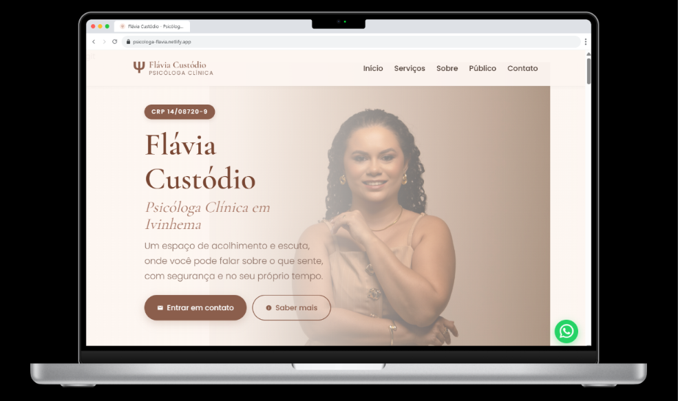
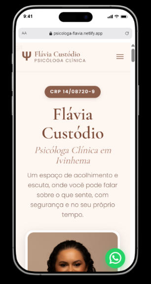

# Landing Page — Psicóloga Flávia Custódio

Landing page institucional desenvolvida para a Psicóloga Flávia Custódio, com foco em apresentação profissional, serviços e canais de contato.

🔗 [Ver projeto online](https://psicologa-flavia.netlify.app/)

## Prévia

<table>
  <tr>
    <td align="center">
      
    </td>
    <td align="center">
      
    </td>
  </tr>
</table>

## Tecnologias

- HTML5
- CSS3
- JavaScript

## Recursos

- Design responsivo com abordagem mobile-first
- Menu de navegação responsivo
- Animações e transições de interface
- Seções de serviços, público atendido e trajetória profissional
- Integração com WhatsApp e Instagram
- Google Maps incorporado
- Botão flutuante do WhatsApp
- Página de privacidade e página 404
- Sitemap e metadados Open Graph
- Políticas de segurança configuradas via `_headers`